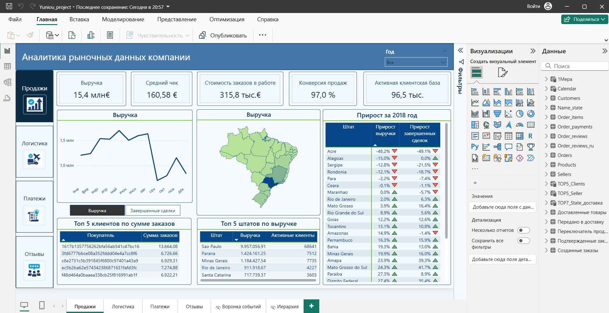
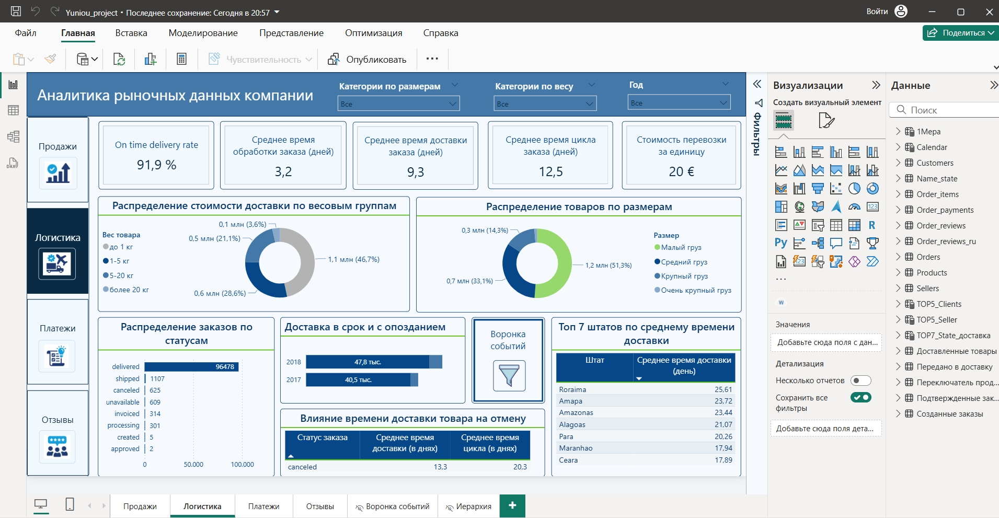
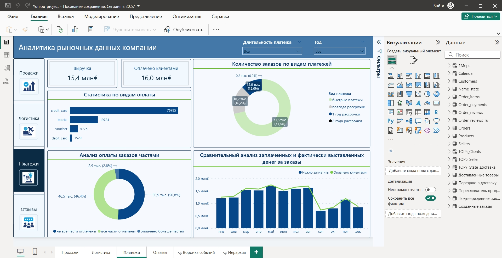

# Sales & Logistics Dashboard (Power BI)

Interaktives Power-BI-Dashboard auf Basis des Olist-E-Commerce-Datensatzes (Bestellungen, Produkte, Zahlungen, Bewertungen, Lieferungen).

## Wichtigste Erkenntnisse
- [z. B. Umsatzentwicklung und Vorjahresvergleich mit Zahl]
- [z. B. Regionen mit höchstem Umsatz oder längster Lieferzeit]
- [z. B. Conversion Rate im Sales Funnel und größter Abbruch]

## Was ich umgesetzt habe
- **Datenaufbereitung:** Power Query, Denormalisierung der Bestelltabelle für den Sales Funnel
- **Datenmodell:** Tabellenbeziehungen, berechnete Spalte für Produktkategorien
- **DAX:** Kennzahlen u. a. Umsatz, Ø Bestellwert, Conversion Rate, aktive Kunden, Vorjahresvergleich
- **Dashboard:** 4 Tabs (Vertrieb, Logistik, Zahlungen, Bewertungen), einheitliches Design
- **Interaktivität:** dynamischer Datumsfilter, Cross-Filtering, Tooltips, Bookmarks, Navigation, Kartenvisualisierung

## Technologien
Power BI, Power Query, DAX
