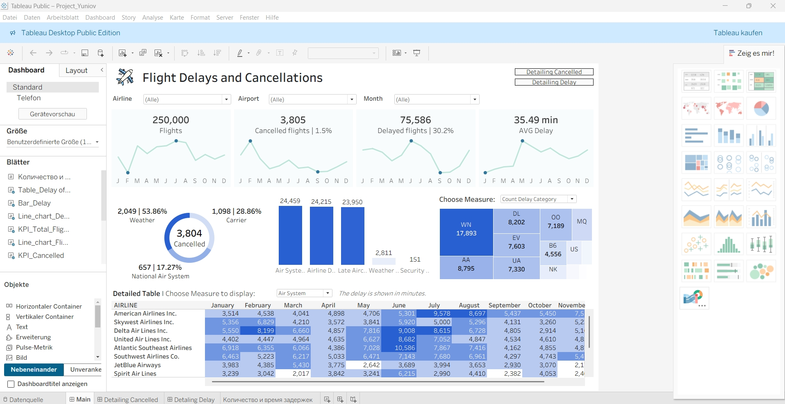
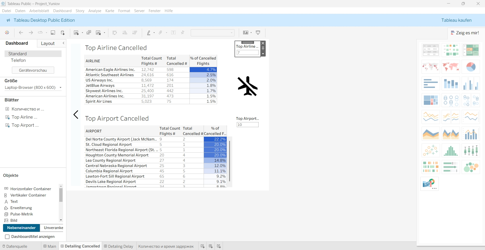
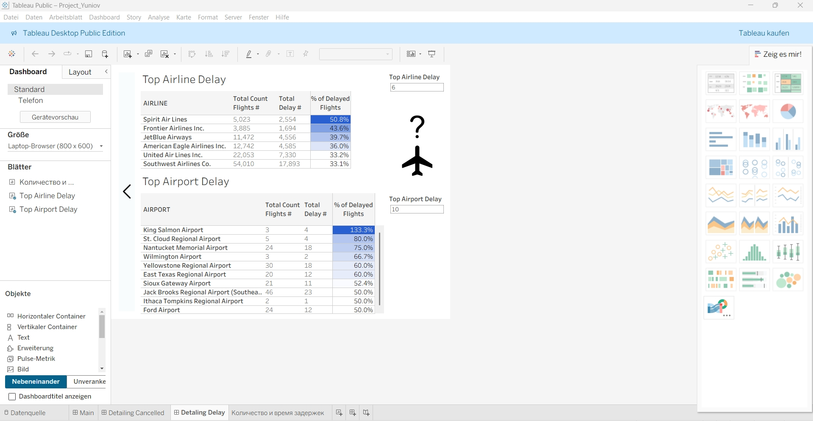

# Analyse von Flugbewegungen (Tableau)

Dashboard zum Vergleich von Flughäfen und Fluggesellschaften mit Fokus auf Verspätungen und Annullierungen.

**Dashboard:** [Tableau Public](https://public.tableau.com/app/profile/aleksandr.yuniou/viz/Project_Yuniov/Main)

## Wichtigste Erkenntnisse
- [z. B. Fluggesellschaft mit höchster Verspätungsquote]
- [z. B. Flughafen mit auffälligen Taxi-Zeiten]
- **Empfehlung:** [z. B. Taxi-Zeit im Flugplan berücksichtigen]

## Was ich umgesetzt habe
- Datenmodell durch physische Joins
- KPI-Kennzahlen, Anteil verspäteter und annullierter Flüge
- Zeitreihe, Dual-Axis-Diagramm
- Parameter, Filter (Datum, Messwert, Dimension), Actions und Tooltips
- Dashboard-Layout nach Gestaltungsprinzipien

## Technologien
Tableau (Public)
